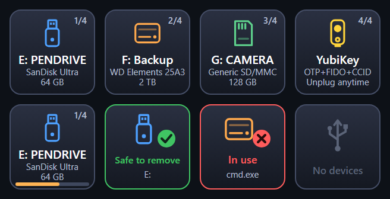

# Elemental USB – Stream Deck plugin

One key for all your USB drives: it shows what's plugged in, a short press switches between devices, and holding the key **safely removes** the one shown, the same as *Safely Remove Hardware* in the Windows tray or the eject button in the Mac Finder.



*Example keys: a pendrive, an external disk, an SD card reader, a YubiKey, the hold-to-eject bar, ejected, blocked by a program, and nothing plugged in.*

## What shows up

The key shows only the devices Windows itself lists under **Safely Remove Hardware** that are connected over USB:

- pendrives, external HDDs and SSDs, SD card readers
- security keys like a YubiKey
- devices behind a USB hub or a docking station

Mice, keyboards, microphones, speakers, webcams, and the Stream Deck itself never show up, so you can't eject them by accident. The plugin doesn't guess from device names. It uses the same Windows check as the tray icon.

Each key shows an icon for the type of device, the drive letter and volume label, the device name and the capacity. With more than one device plugged in, a counter in the corner (for example `2/3`) shows where you are.

## Install

1. Download `com.elemental.usb.streamDeckPlugin` from the [latest release](../../releases/latest) and double-click it.
2. Drag **Safely Remove USB** (category **Elemental USB**) onto a key.

Requirements: Windows 10/11 or macOS 12+, and Stream Deck software **7.1** or newer. No admin rights are needed.

## Using it

| Action | What happens |
| --- | --- |
| Short press | Show the next device |
| Hold (0.8 s by default) | A bar fills along the bottom, then the device is ejected |
| **Safe to remove** (green) | You can unplug it now |
| **In use** (red) | A program still has a file or folder open on the drive. The key shows which one (for example `cmd.exe`). Close it and try again |
| **No devices** | Nothing removable is plugged in. The key updates by itself about a second after you plug something in |

Settings: key language (Automatic, English, Polish) and how long to hold (0.5 / 0.8 / 1.2 s).

> Programs like Notepad read a file and close it right away, so having a text file open doesn't block ejecting. That is normal Windows behavior.

## macOS

On a Mac the key shows external USB drives and SD cards – everything `diskutil list external physical` reports over USB or the SD slot. Instead of a drive letter it shows the volume name. Holding the key runs `diskutil eject`; when a program keeps the drive busy, the key names it (from `diskutil` or `lsof`). Security keys like a YubiKey are not drives on macOS, so they don't show up. Only tools that come with macOS are used.

## Notes

- On Windows the plugin starts a small `powershell.exe` helper that lists devices and ejects them through the Windows Configuration Manager API. Locked-down PCs or aggressive antivirus software may block it.
- To name the program that blocks ejecting, the helper reads the Windows *System* event log (Kernel-PnP event 225).
- Nothing is sent over the network.

## Development

```
npm install
npm run link        # once: link the plugin folder into Stream Deck
npm run deploy      # build + restart the plugin (Stream Deck restarts it by itself)
npm run typecheck
npm run icons       # regenerate the PNG icons (uses Microsoft Edge headless)
npx streamdeck pack com.elemental.usb.sdPlugin --output dist --force
```

- `com.elemental.usb.sdPlugin/bin/usb-helper.ps1`: device list and eject (C# via `Add-Type`, `cfgmgr32.dll`). A device shows up when it is the nearest removable (`CM_DEVCAP_REMOVABLE`) ancestor of a device node that is not safe to surprise-remove (no `CM_DEVCAP_SURPRISEREMOVALOK`) and sits under a USB node, which is how the tray builds its list.
- `com.elemental.usb.sdPlugin/bin/usb-helper-mac.mjs`: the same for macOS (`diskutil`, `plutil`, `lsof`), run with the Node.js that Stream Deck ships
- `src/plugin.ts`: the action (short press / hold), helper process, language
- `src/render.ts`: SVG key rendering and device icons
- `com.elemental.usb.sdPlugin/ui/eject.html`: settings page (English / Polish)

## License

MIT, see [LICENSE](LICENSE). Third-party components bundled with the plugin and their licenses are listed in [THIRD-PARTY-NOTICES.txt](THIRD-PARTY-NOTICES.txt).
